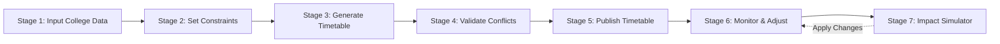
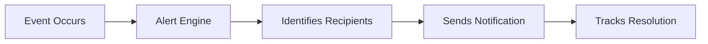

# TIMEVERSE — Complete Timetable Planner, Alerts & Role-Based Access System

[](https://fastapi.tiangolo.com/)
[](https://nextjs.org/)
[](https://developers.google.com/optimization)
[](https://tailwindcss.com/)
[](https://www.python.org/)
[](https://opensource.org/licenses/MIT)

**Institution:** Kristu Jayanti University (Autonomous), Bengaluru  
**Department:** Department of Professional Management Studies (DPMS)  
**Repository:** [https://github.com/Ashutoshkhalkho/Time-verse-.git](https://github.com/Ashutoshkhalkho/Time-verse-.git)

---

## 📌 Executive Overview

**TIMEVERSE** is an institutional academic scheduling and real-time operations platform built specifically for university departmental governance. It combines mathematical constraint satisfaction (Google OR-Tools CP-SAT), a multi-channel smart alert lifecycle, strict server-side Role-Based Access Control (RBAC), and an interactive **Impact Simulator** for schedule disruptions.

The platform implements two core connected institutional workflows:
1. **Timetable Planner Workflow** (7 Stages)
2. **Alert System Workflow** (5 Stages)

---

## 🔄 Dual Core Workflows

### 1. Timetable Planner Workflow (7 Stages)



- **Stage 1 — Input College Data:** Manage teachers, courses, sections, lecture halls/labs, period time slots, and weekly teaching requirements via interactive wizards or CSV/Excel imports. Validates required columns, duplicate records, and room type mismatches before saving.
- **Stage 2 — Set Constraints:** Configures hard constraints (zero teacher/room/section double-bookings, workload limits, lab requirements, lunch break preservation) and soft constraints (teacher preferences, gap minimization, workload balancing across weekdays).
- **Stage 3 — Generate Timetable:** Powered by **Google OR-Tools CP-SAT** solver running against actual database records. Guarantees zero hallucinated faculty or rooms.
- **Stage 4 — Validate & Check Conflicts:** Detects teacher clashes, room overlaps, cohort double-bookings, and room capacity issues. Schedules with hard-constraint violations cannot be published.
- **Stage 5 — Publish Timetable:** Structured HOD approval pipeline: `Draft → Validation → HOD Approval → Published`. Publication locks approved sessions (`is_locked = True`), creates revision history, and sends ripple alerts. Unpublished drafts remain invisible to students.
- **Stage 6 — Monitor & Adjust:** Real-time handling of emergency faculty leave, room maintenance, and session swaps. Locked sessions reject modifications (`409 Conflict`) without authorized unlock.
- **Stage 7 — Impact Simulator:** Simulates changes before applying them, previewing affected classes, teacher workload shifts, and alternative slots ranked by soft-constraint scores. Includes an authorized **"Apply Change (HOD)"** action that revalidates constraints and dispatches ripple notifications.

---

### 2. Alert System Workflow (5 Stages)



- **Stage 1 — Event Occurs:** Schedule changes, hard clashes, faculty absences, or timetable publications trigger the event pipeline.
- **Stage 2 — Alert Engine:** Applies 5-minute sliding deduplication to prevent notification fatigue, categorizes events into 4 distinct institutional tiers, and computes severity scores (`INFO`, `WARNING`, `CRITICAL`).
- **Stage 3 — Identifies Recipients:** Resolves exact stakeholders (HOD, affected faculty, enrolled students, section Class Representatives).
- **Stage 4 — Sends Notification:** Multi-channel delivery across `In-App`, verified `Email (SMTP)`, and `Push`. Features a live **"Retry Channel"** mechanism for failed deliveries.
- **Stage 5 — Tracks Resolution:** Progresses through `PENDING ➔ UNDER_REVIEW ➔ RESOLVED`. HOD and coordinators log resolution notes with full audit timestamps.

#### Supported Alert Categories:
- **Category A (Conflict Alerts):** Overlaps and double-booking details dispatched to HOD and coordinators.
- **Category B (Timetable Change Alerts):** Targeted ripple notices sent to teachers and students for rescheduled classes.
- **Category C (Emergency Alerts):** Sudden faculty leaves or facility lockdowns broadcast by HOD/Admin.
- **Category D (Administrative Alerts):** Workload overages and resource utilization warnings sent to management.

---

## 👥 Strict Role-Based Access Control (RBAC)

Permissions are enforced on **all API endpoints and database mutations**, never relying on frontend visibility alone:

| Role | Timetable View | Edit / Create / Delete | Generate (CP-SAT) | Approve & Publish | Simulator Apply | Emergency Broadcast |
|---|---|---|---|---|---|---|
| **HOD** | Department-wide | ✅ Yes | ✅ Yes | ✅ Yes | ✅ Yes | ✅ Yes |
| **Faculty / Teacher** | Personal Schedule | ❌ No (Request Only) | ❌ No | ❌ No | ❌ No | ❌ No |
| **Class Representative** | Assigned Section (CS-3A) | ❌ No | ❌ No | ❌ No | ❌ No | ❌ No |
| **Student** | **Strictly VIEW-ONLY** | ❌ **Rejected (403)** | ❌ **Rejected (403)** | ❌ **Rejected (403)** | ❌ **Rejected (403)** | ❌ **Rejected (403)** |
| **College Management** | Cross-Department | ❌ No (View Only) | ❌ No | ❌ No | ❌ No | ❌ No |

### Student Security Lockdown
- **View-Only Access:** Student accounts cannot create, edit, delete, generate, lock, or publish sessions. All modification API endpoints return `403 Forbidden`.
- **Section Scoping:** Students can only view their assigned section (`CS-3A`). Requests for other sections are denied with `403 Forbidden`.
- **Draft Protection:** Unpublished drafts are inaccessible to students and CRs.
- **UI Lockdown:** All mutation buttons, generators, and section switchers are automatically hidden or locked.

---

## 📅 Timetable Display Format

The timetable follows the institutional Kristu Jayanti University specification:
- **Department Header:** *Kristu Jayanti University • Department of Professional Management Studies • Class Timetable*.
- **Grouped Day Rows:** Monday through Saturday.
- **Three Subrows Per Day:**
  1. **Course Row:** Subject Code & Course Title
  2. **Faculty Row:** Assigned Teacher Name
  3. **Room Row:** Classroom / Laboratory Number & Type
- **Designated Lunch Break Column:** Spans all three subrows vertically between configured periods.
- **View Modes:** University Matrix (3-Subrow), Card Grid, and Daily Timeline.
- **Print Friendly:** Landscape optimization (`@media print`) for clear exports.

---

## 🛠️ Technology Stack

- **Backend:**
  - Python 3.12+ / 3.13
  - **FastAPI** (Async REST API & Dependency Injection)
  - **SQLAlchemy 2.0** + SQLite / PostgreSQL
  - **Google OR-Tools CP-SAT** (Integer Optimization Solver)
  - **Pydantic v2** (Request Validation & Schemas)
  - **Pytest** (Automated Test Suite)
- **Frontend:**
  - **Next.js 14.2 (App Router)** & React 18
  - **TypeScript** (Strict Type Safety)
  - **Tailwind CSS** (Institutional Design System)
  - **Lucide React** (Iconography)

---

## 🚀 Quickstart & Local Setup

### 1. Clone the Repository

```bash
git clone https://github.com/Ashutoshkhalkho/Time-verse-.git
cd Time-verse-
```

### 2. Backend Setup

```bash
cd backend

# Create & activate virtual environment
python -m venv .venv

# On Windows (PowerShell):
.venv\Scripts\Activate.ps1
# On Linux/macOS:
# source .venv/bin/activate

# Install dependencies
pip install -r requirements.txt

# Start the FastAPI server
python -m uvicorn app.main:app --host 0.0.0.0 --port 8000 --reload
```

Backend API will be running at: **[http://localhost:8000](http://localhost:8000)**  
Interactive Swagger Docs: **[http://localhost:8000/docs](http://localhost:8000/docs)**

### 3. Frontend Setup

In a new terminal window:

```bash
cd frontend

# Install Node dependencies
npm install

# Run the development server
npm run dev

# Or build for production
npm run build
npm start
```

Frontend application will be running at: **[http://localhost:3000](http://localhost:3000)**

---

## 🧪 Automated Testing Suite

The repository includes a comprehensive 11-scenario automated test suite validating every requirement:

```bash
cd backend
python -m pytest tests/test_timetable_planner_and_alerts.py -v
```

### Verified Test Gates:
1. `test_scenario_1_hod_workflow`: HOD generates, edits, validates, and publishes a valid timetable with locked sessions.
2. `test_scenario_2_conflict_prevents_publishing`: Hard-constraint double-booking conflict returns `409 Conflict` and prevents publishing.
3. `test_scenario_3_simulator_impact_display`: Impact simulator computes directly affected sessions and ranked alternatives.
4. `test_scenario_4_change_generates_ripple_alerts`: Timetable change dispatches Category B ripple notifications.
5. `test_scenario_5_faculty_permissions`: Faculty can view their schedule, but mutations without authorization are rejected (`403 Forbidden`).
6. `test_scenario_6_cr_section_restriction`: CR can access assigned section `CS-3A`, but other sections return `403 Forbidden`.
7. `test_scenario_7_student_view_and_export`: Student views and exports published timetable for assigned section.
8. `test_scenario_8_student_mutations_strictly_rejected`: Student attempts to create, update, delete, generate, or publish return `403 Forbidden`.
9. `test_scenario_9_unpublished_draft_inaccessible`: Unpublished draft timetables return `403 Forbidden` to unauthorized users.
10. `test_scenario_10_alert_deduplication_and_retry`: 5-minute sliding window suppresses duplicate alerts; delivery retry endpoint works.
11. `test_scenario_11_simulator_apply_changes`: HOD applies simulated alternative, revalidating constraints and sending ripple alerts.

---

## 🔑 Demo Personas & Credentials

All test accounts share the demo password: `DemoPass@2026!`

| Role | Email | Description |
|---|---|---|
| **Head of Department (CS)** | `hod.cs@timewise.edu` | Full administrative controls, CP-SAT generation, publishing, and emergency alerts |
| **Faculty / Teacher** | `teacher.sharma@timewise.edu` | Personal timetable view, lecture highlighting, availability submissions |
| **Class Representative** | `cr.cs3a@timewise.edu` | Section CS-3A view-only access, classroom issue reporting |
| **Student** | `student.aarav@timewise.edu` | Strictly view-only, locked to Section CS-3A |
| **College Management** | `admin@timewise.edu` | Cross-department resource utilization and governance |

---

## 📄 License

This project is licensed under the MIT License — see the LICENSE file for details.
