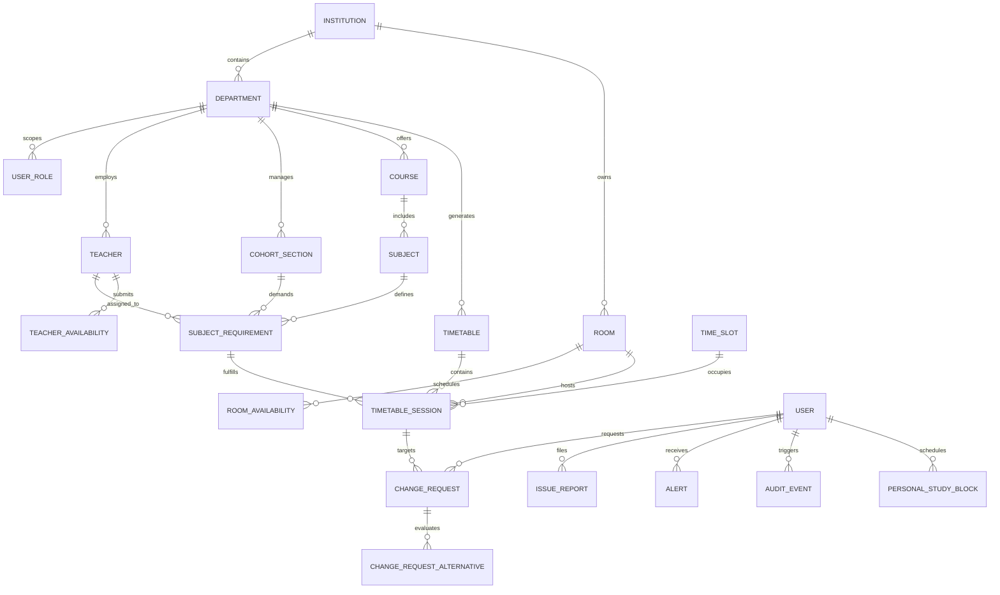

# TIMEWISE — Database Design & Schema Specification

**Version:** 1.0  
**Date:** October 2026  
**Status:** Approved for Implementation  
**Database Engine:** PostgreSQL 16+  
**ORM / Migration Tool:** SQLAlchemy 2.0 (Async) + Alembic

---

## 1. Architectural Strategy & Conventions

The database schema is designed for multi-tenant scalability (scoped by Institution and Department), strict referential integrity, timetable versioning, immutable audit tracking, and atomic scheduling transactions.

### 1.1 Design Conventions
* **Primary Keys:** ULID or UUIDv7 stored as `VARCHAR(26)` or `UUID` (ordered by time to optimize B-Tree index locality).
* **Timestamps:** `TIMESTAMPTZ` (UTC) with default `CURRENT_TIMESTAMP`.
* **Foreign Keys:** Explicit foreign key constraints with `ON DELETE RESTRICT` for financial and academic records, and `ON DELETE CASCADE` for transient child elements (e.g., sessions of a deleted draft).
* **Naming Conventions:** Snake_case for tables and columns; singular nouns for table names (`timetable_session` vs `timetables`, or clear relational plural where standard).
* **JSON Usage:** `JSONB` for unstructured configuration, equipment specifications, solver diagnostics, and audit diffs.

---

## 2. Entity-Relationship Model (Mermaid Diagram)



---

## 3. Schema DDL & Table Specifications

### 3.1 Organization & Scoping Core

#### `institutions`
Represents the educational institution.
```sql
CREATE TABLE institutions (
    id VARCHAR(26) PRIMARY KEY,
    name VARCHAR(255) NOT NULL,
    code VARCHAR(50) UNIQUE NOT NULL,
    timezone VARCHAR(50) DEFAULT 'Asia/Kolkata' NOT NULL,
    operating_hours JSONB NOT NULL DEFAULT '{"start": "08:30", "end": "16:30", "days": [1,2,3,4,5,6]}',
    created_at TIMESTAMPTZ DEFAULT CURRENT_TIMESTAMP NOT NULL,
    updated_at TIMESTAMPTZ DEFAULT CURRENT_TIMESTAMP NOT NULL
);
```

#### `departments`
Academic departments (e.g., Computer Science, Mechanical).
```sql
CREATE TABLE departments (
    id VARCHAR(26) PRIMARY KEY,
    institution_id VARCHAR(26) NOT NULL REFERENCES institutions(id) ON DELETE RESTRICT,
    name VARCHAR(255) NOT NULL,
    code VARCHAR(20) NOT NULL,
    hod_user_id VARCHAR(26),
    created_at TIMESTAMPTZ DEFAULT CURRENT_TIMESTAMP NOT NULL,
    updated_at TIMESTAMPTZ DEFAULT CURRENT_TIMESTAMP NOT NULL,
    CONSTRAINT uq_dept_institution_code UNIQUE (institution_id, code)
);
```

#### `academic_terms`
Semester / academic period.
```sql
CREATE TABLE academic_terms (
    id VARCHAR(26) PRIMARY KEY,
    institution_id VARCHAR(26) NOT NULL REFERENCES institutions(id) ON DELETE RESTRICT,
    name VARCHAR(100) NOT NULL,
    start_date DATE NOT NULL,
    end_date DATE NOT NULL,
    is_active BOOLEAN DEFAULT FALSE NOT NULL,
    created_at TIMESTAMPTZ DEFAULT CURRENT_TIMESTAMP NOT NULL,
    CONSTRAINT chk_term_dates CHECK (end_date > start_date)
);
```

---

### 3.2 Identity, Roles & User Scope

#### `users`
System accounts across all persona levels.
```sql
CREATE TYPE user_role_enum AS ENUM (
    'ADMIN',
    'HOD',
    'COORDINATOR',
    'TEACHER',
    'CR',
    'STUDENT'
);

CREATE TABLE users (
    id VARCHAR(26) PRIMARY KEY,
    institution_id VARCHAR(26) NOT NULL REFERENCES institutions(id) ON DELETE RESTRICT,
    email VARCHAR(255) UNIQUE NOT NULL,
    hashed_password VARCHAR(255) NOT NULL,
    full_name VARCHAR(255) NOT NULL,
    phone VARCHAR(20),
    role user_role_enum NOT NULL,
    is_active BOOLEAN DEFAULT TRUE NOT NULL,
    notification_preferences JSONB DEFAULT '{"in_app": true, "email": true}' NOT NULL,
    created_at TIMESTAMPTZ DEFAULT CURRENT_TIMESTAMP NOT NULL,
    updated_at TIMESTAMPTZ DEFAULT CURRENT_TIMESTAMP NOT NULL
);
CREATE INDEX idx_users_institution_role ON users(institution_id, role);
```

#### `user_department_scopes`
Explicit jurisdictional boundaries for HODs, Coordinators, and Faculty.
```sql
CREATE TABLE user_department_scopes (
    id VARCHAR(26) PRIMARY KEY,
    user_id VARCHAR(26) NOT NULL REFERENCES users(id) ON DELETE CASCADE,
    department_id VARCHAR(26) NOT NULL REFERENCES departments(id) ON DELETE CASCADE,
    is_primary BOOLEAN DEFAULT TRUE NOT NULL,
    created_at TIMESTAMPTZ DEFAULT CURRENT_TIMESTAMP NOT NULL,
    CONSTRAINT uq_user_dept_scope UNIQUE (user_id, department_id)
);
```

---

### 3.3 Academic Entities & Physical Infrastructure

#### `teachers`
Teacher-specific profile and constraints.
```sql
CREATE TABLE teachers (
    id VARCHAR(26) PRIMARY KEY,
    user_id VARCHAR(26) UNIQUE NOT NULL REFERENCES users(id) ON DELETE RESTRICT,
    department_id VARCHAR(26) NOT NULL REFERENCES departments(id) ON DELETE RESTRICT,
    employee_code VARCHAR(50) NOT NULL,
    max_hours_per_day INT DEFAULT 5 NOT NULL,
    max_consecutive_hours INT DEFAULT 3 NOT NULL,
    max_weekly_hours INT DEFAULT 20 NOT NULL,
    created_at TIMESTAMPTZ DEFAULT CURRENT_TIMESTAMP NOT NULL,
    CONSTRAINT uq_teacher_dept_code UNIQUE (department_id, employee_code)
);
CREATE INDEX idx_teachers_dept ON teachers(department_id);
```

#### `cohort_sections`
Student sections/batches.
```sql
CREATE TABLE cohort_sections (
    id VARCHAR(26) PRIMARY KEY,
    department_id VARCHAR(26) NOT NULL REFERENCES departments(id) ON DELETE RESTRICT,
    academic_term_id VARCHAR(26) NOT NULL REFERENCES academic_terms(id) ON DELETE RESTRICT,
    program_name VARCHAR(100) NOT NULL,
    year_level INT NOT NULL,
    section_name VARCHAR(20) NOT NULL,
    student_count INT NOT NULL CHECK (student_count > 0),
    cr_user_id VARCHAR(26) REFERENCES users(id) ON DELETE SET NULL,
    created_at TIMESTAMPTZ DEFAULT CURRENT_TIMESTAMP NOT NULL,
    CONSTRAINT uq_cohort_section UNIQUE (department_id, academic_term_id, program_name, year_level, section_name)
);
```

#### `student_enrollments`
Enrolls students into sections.
```sql
CREATE TABLE student_enrollments (
    id VARCHAR(26) PRIMARY KEY,
    student_user_id VARCHAR(26) NOT NULL REFERENCES users(id) ON DELETE CASCADE,
    cohort_section_id VARCHAR(26) NOT NULL REFERENCES cohort_sections(id) ON DELETE RESTRICT,
    is_active BOOLEAN DEFAULT TRUE NOT NULL,
    created_at TIMESTAMPTZ DEFAULT CURRENT_TIMESTAMP NOT NULL,
    CONSTRAINT uq_student_section UNIQUE (student_user_id, cohort_section_id)
);
```

#### `rooms`
Physical spaces and facilities.
```sql
CREATE TYPE room_type_enum AS ENUM (
    'LECTURE_HALL',
    'COMPUTER_LAB',
    'SCIENCE_LAB',
    'SEMINAR_ROOM',
    'WORKSHOP'
);

CREATE TABLE rooms (
    id VARCHAR(26) PRIMARY KEY,
    institution_id VARCHAR(26) NOT NULL REFERENCES institutions(id) ON DELETE RESTRICT,
    building VARCHAR(100) NOT NULL,
    room_number VARCHAR(50) NOT NULL,
    capacity INT NOT NULL CHECK (capacity > 0),
    room_type room_type_enum NOT NULL,
    equipment JSONB DEFAULT '[]' NOT NULL,
    is_active BOOLEAN DEFAULT TRUE NOT NULL,
    created_at TIMESTAMPTZ DEFAULT CURRENT_TIMESTAMP NOT NULL,
    CONSTRAINT uq_institution_room UNIQUE (institution_id, building, room_number)
);
CREATE INDEX idx_rooms_type_capacity ON rooms(room_type, capacity);
```

#### `time_slots`
Standardized timetable periods.
```sql
CREATE TABLE time_slots (
    id VARCHAR(26) PRIMARY KEY,
    institution_id VARCHAR(26) NOT NULL REFERENCES institutions(id) ON DELETE RESTRICT,
    day_of_week INT NOT NULL CHECK (day_of_week BETWEEN 1 AND 6), -- 1=Monday, 6=Saturday
    period_number INT NOT NULL CHECK (period_number BETWEEN 1 AND 10),
    start_time TIME NOT NULL,
    end_time TIME NOT NULL,
    is_break BOOLEAN DEFAULT FALSE NOT NULL,
    created_at TIMESTAMPTZ DEFAULT CURRENT_TIMESTAMP NOT NULL,
    CONSTRAINT uq_timeslot_day_period UNIQUE (institution_id, day_of_week, period_number),
    CONSTRAINT chk_timeslot_span CHECK (end_time > start_time)
);
CREATE INDEX idx_timeslots_day ON time_slots(day_of_week, period_number);
```

---

### 3.4 Curriculum & Teaching Requirements

#### `subjects`
Courses and curricular units.
```sql
CREATE TYPE subject_type_enum AS ENUM (
    'THEORY',
    'LABORATORY',
    'SEMINAR',
    'PROJECT'
);

CREATE TABLE subjects (
    id VARCHAR(26) PRIMARY KEY,
    department_id VARCHAR(26) NOT NULL REFERENCES departments(id) ON DELETE RESTRICT,
    code VARCHAR(50) NOT NULL,
    name VARCHAR(255) NOT NULL,
    credits INT NOT NULL DEFAULT 3,
    subject_type subject_type_enum NOT NULL DEFAULT 'THEORY',
    required_room_type room_type_enum NOT NULL DEFAULT 'LECTURE_HALL',
    created_at TIMESTAMPTZ DEFAULT CURRENT_TIMESTAMP NOT NULL,
    CONSTRAINT uq_dept_subject_code UNIQUE (department_id, code)
);
```

#### `subject_requirements`
Curriculum mapping demanding slots for a section.
```sql
CREATE TABLE subject_requirements (
    id VARCHAR(26) PRIMARY KEY,
    cohort_section_id VARCHAR(26) NOT NULL REFERENCES cohort_sections(id) ON DELETE RESTRICT,
    subject_id VARCHAR(26) NOT NULL REFERENCES subjects(id) ON DELETE RESTRICT,
    teacher_id VARCHAR(26) NOT NULL REFERENCES teachers(id) ON DELETE RESTRICT,
    required_sessions_per_week INT NOT NULL CHECK (required_sessions_per_week > 0),
    duration_periods INT NOT NULL DEFAULT 1 CHECK (duration_periods BETWEEN 1 AND 4),
    requires_consecutive_periods BOOLEAN NOT NULL DEFAULT FALSE,
    preferred_room_id VARCHAR(26) REFERENCES rooms(id) ON DELETE SET NULL,
    created_at TIMESTAMPTZ DEFAULT CURRENT_TIMESTAMP NOT NULL,
    CONSTRAINT uq_section_subject UNIQUE (cohort_section_id, subject_id)
);
```

#### `teacher_availabilities` & `teacher_preferences`
```sql
CREATE TABLE teacher_availabilities (
    id VARCHAR(26) PRIMARY KEY,
    teacher_id VARCHAR(26) NOT NULL REFERENCES teachers(id) ON DELETE CASCADE,
    time_slot_id VARCHAR(26) NOT NULL REFERENCES time_slots(id) ON DELETE CASCADE,
    is_available BOOLEAN DEFAULT TRUE NOT NULL,
    preference_weight INT DEFAULT 0 NOT NULL, -- -2: Strongly Avoid, 0: Neutral, +2: Preferred
    reason VARCHAR(255),
    CONSTRAINT uq_teacher_slot UNIQUE (teacher_id, time_slot_id)
);
```

---

### 3.5 Timetables, Sessions & Versions

#### `timetables`
Timetable root container tracking publishing state and versions.
```sql
CREATE TYPE timetable_status_enum AS ENUM (
    'DRAFT',
    'SIMULATED',
    'PROPOSED',
    'PUBLISHED',
    'ARCHIVED'
);

CREATE TABLE timetables (
    id VARCHAR(26) PRIMARY KEY,
    department_id VARCHAR(26) NOT NULL REFERENCES departments(id) ON DELETE RESTRICT,
    academic_term_id VARCHAR(26) NOT NULL REFERENCES academic_terms(id) ON DELETE RESTRICT,
    version_major INT DEFAULT 1 NOT NULL,
    version_minor INT DEFAULT 0 NOT NULL,
    status timetable_status_enum DEFAULT 'DRAFT' NOT NULL,
    solver_status VARCHAR(50),
    solver_score JSONB,
    created_by_user_id VARCHAR(26) NOT NULL REFERENCES users(id) ON DELETE RESTRICT,
    approved_by_user_id VARCHAR(26) REFERENCES users(id) ON DELETE RESTRICT,
    published_at TIMESTAMPTZ,
    notes TEXT,
    created_at TIMESTAMPTZ DEFAULT CURRENT_TIMESTAMP NOT NULL,
    updated_at TIMESTAMPTZ DEFAULT CURRENT_TIMESTAMP NOT NULL,
    CONSTRAINT uq_dept_term_version UNIQUE (department_id, academic_term_id, version_major, version_minor)
);
CREATE INDEX idx_timetables_status ON timetables(department_id, status);
```

#### `timetable_sessions`
Assigned timetable entries.
```sql
CREATE TYPE session_status_enum AS ENUM (
    'OFFICIAL',
    'TENTATIVE',
    'RESCHEDULED',
    'CANCELLED'
);

CREATE TABLE timetable_sessions (
    id VARCHAR(26) PRIMARY KEY,
    timetable_id VARCHAR(26) NOT NULL REFERENCES timetables(id) ON DELETE CASCADE,
    requirement_id VARCHAR(26) NOT NULL REFERENCES subject_requirements(id) ON DELETE RESTRICT,
    cohort_section_id VARCHAR(26) NOT NULL REFERENCES cohort_sections(id) ON DELETE RESTRICT,
    subject_id VARCHAR(26) NOT NULL REFERENCES subjects(id) ON DELETE RESTRICT,
    teacher_id VARCHAR(26) NOT NULL REFERENCES teachers(id) ON DELETE RESTRICT,
    room_id VARCHAR(26) NOT NULL REFERENCES rooms(id) ON DELETE RESTRICT,
    time_slot_id VARCHAR(26) NOT NULL REFERENCES time_slots(id) ON DELETE RESTRICT,
    status session_status_enum DEFAULT 'OFFICIAL' NOT NULL,
    created_at TIMESTAMPTZ DEFAULT CURRENT_TIMESTAMP NOT NULL,
    updated_at TIMESTAMPTZ DEFAULT CURRENT_TIMESTAMP NOT NULL
);

-- Essential Performance Indexes
CREATE INDEX idx_session_lookup ON timetable_sessions(timetable_id, time_slot_id);
CREATE INDEX idx_session_teacher ON timetable_sessions(teacher_id, time_slot_id);
CREATE INDEX idx_session_room ON timetable_sessions(room_id, time_slot_id);
CREATE INDEX idx_session_cohort ON timetable_sessions(cohort_section_id, time_slot_id);

-- Partial Unique Constraints to enforce hard constraints in published timetables at DB level
-- Note: Revalidation engine tests all constraints, but unique indexes guarantee transactional safety.
```

---

### 3.6 Change Requests, Alternatives & Impact Simulator

#### `change_requests`
Formal faculty/coordinator change workflow.
```sql
CREATE TYPE request_status_enum AS ENUM (
    'SUBMITTED',
    'UNDER_REVIEW',
    'ALTERNATIVES_PROPOSED',
    'APPROVED',
    'REJECTED',
    'CANCELLED'
);

CREATE TYPE change_request_type_enum AS ENUM (
    'RESCHEDULE_SESSION',
    'SWAP_ROOM',
    'SUBSTITUTE_TEACHER',
    'CANCEL_SESSION'
);

CREATE TABLE change_requests (
    id VARCHAR(26) PRIMARY KEY,
    timetable_id VARCHAR(26) NOT NULL REFERENCES timetables(id) ON DELETE RESTRICT,
    target_session_id VARCHAR(26) NOT NULL REFERENCES timetable_sessions(id) ON DELETE RESTRICT,
    requester_user_id VARCHAR(26) NOT NULL REFERENCES users(id) ON DELETE RESTRICT,
    request_type change_request_type_enum NOT NULL,
    proposed_time_slot_id VARCHAR(26) REFERENCES time_slots(id) ON DELETE SET NULL,
    proposed_room_id VARCHAR(26) REFERENCES rooms(id) ON DELETE SET NULL,
    proposed_teacher_id VARCHAR(26) REFERENCES teachers(id) ON DELETE SET NULL,
    reason TEXT NOT NULL,
    status request_status_enum DEFAULT 'SUBMITTED' NOT NULL,
    reviewer_user_id VARCHAR(26) REFERENCES users(id) ON DELETE SET NULL,
    review_decision_reason TEXT,
    reviewed_at TIMESTAMPTZ,
    created_at TIMESTAMPTZ DEFAULT CURRENT_TIMESTAMP NOT NULL,
    updated_at TIMESTAMPTZ DEFAULT CURRENT_TIMESTAMP NOT NULL
);
CREATE INDEX idx_change_requests_status ON change_requests(timetable_id, status);
```

#### `change_request_alternatives`
Optimizer-generated feasible options with trade-off analysis.
```sql
CREATE TABLE change_request_alternatives (
    id VARCHAR(26) PRIMARY KEY,
    change_request_id VARCHAR(26) NOT NULL REFERENCES change_requests(id) ON DELETE CASCADE,
    option_rank INT NOT NULL,
    proposed_time_slot_id VARCHAR(26) NOT NULL REFERENCES time_slots(id) ON DELETE RESTRICT,
    proposed_room_id VARCHAR(26) NOT NULL REFERENCES rooms(id) ON DELETE RESTRICT,
    proposed_teacher_id VARCHAR(26) NOT NULL REFERENCES teachers(id) ON DELETE RESTRICT,
    affected_sessions_count INT DEFAULT 0 NOT NULL,
    soft_penalty_score NUMERIC(10,2) NOT NULL,
    trade_off_explanation JSONB NOT NULL,
    is_selected BOOLEAN DEFAULT FALSE NOT NULL,
    created_at TIMESTAMPTZ DEFAULT CURRENT_TIMESTAMP NOT NULL
);
```

---

### 3.7 Issues, Alerts, Student Blocks & Audit Trail

#### `issue_reports`
CR or staff reported problems (e.g., room projector broken, room locked).
```sql
CREATE TYPE issue_status_enum AS ENUM (
    'PENDING',
    'UNDER_REVIEW',
    'RESOLVED',
    'DISMISSED'
);

CREATE TABLE issue_reports (
    id VARCHAR(26) PRIMARY KEY,
    reporter_user_id VARCHAR(26) NOT NULL REFERENCES users(id) ON DELETE RESTRICT,
    room_id VARCHAR(26) REFERENCES rooms(id) ON DELETE SET NULL,
    affected_time_slot_id VARCHAR(26) REFERENCES time_slots(id) ON DELETE SET NULL,
    target_date DATE NOT NULL,
    issue_category VARCHAR(100) NOT NULL, -- 'ROOM_UNAVAILABLE', 'TEACHER_ABSENT', etc.
    description TEXT NOT NULL,
    evidence_url VARCHAR(500),
    status issue_status_enum DEFAULT 'PENDING' NOT NULL,
    resolver_user_id VARCHAR(26) REFERENCES users(id) ON DELETE SET NULL,
    resolution_notes TEXT,
    created_at TIMESTAMPTZ DEFAULT CURRENT_TIMESTAMP NOT NULL,
    updated_at TIMESTAMPTZ DEFAULT CURRENT_TIMESTAMP NOT NULL
);
```

#### `alerts`
Targeted user notifications.
```sql
CREATE TYPE alert_severity_enum AS ENUM (
    'CRITICAL',
    'HIGH',
    'MEDIUM',
    'INFORMATIONAL'
);

CREATE TABLE alerts (
    id VARCHAR(26) PRIMARY KEY,
    recipient_user_id VARCHAR(26) NOT NULL REFERENCES users(id) ON DELETE CASCADE,
    event_type VARCHAR(100) NOT NULL,
    severity alert_severity_enum NOT NULL,
    title VARCHAR(255) NOT NULL,
    message TEXT NOT NULL,
    action_url VARCHAR(500),
    is_read BOOLEAN DEFAULT FALSE NOT NULL,
    read_at TIMESTAMPTZ,
    deduplication_key VARCHAR(128) NOT NULL,
    created_at TIMESTAMPTZ DEFAULT CURRENT_TIMESTAMP NOT NULL
);
CREATE INDEX idx_alerts_recipient_read ON alerts(recipient_user_id, is_read, created_at DESC);
CREATE INDEX idx_alerts_dedup ON alerts(deduplication_key, created_at);
```

#### `personal_study_blocks`
Client-side / student self-study time blocks from Design Doc.
```sql
CREATE TABLE personal_study_blocks (
    id VARCHAR(26) PRIMARY KEY,
    user_id VARCHAR(26) NOT NULL REFERENCES users(id) ON DELETE CASCADE,
    title VARCHAR(200) NOT NULL,
    block_date DATE NOT NULL,
    start_time TIME NOT NULL,
    end_time TIME NOT NULL,
    notes TEXT,
    created_at TIMESTAMPTZ DEFAULT CURRENT_TIMESTAMP NOT NULL,
    CONSTRAINT chk_study_block_span CHECK (end_time > start_time)
);
CREATE INDEX idx_study_blocks_user_date ON personal_study_blocks(user_id, block_date);
```

#### `audit_events`
Immutable compliance and forensic log.
```sql
CREATE TABLE audit_events (
    id VARCHAR(26) PRIMARY KEY,
    actor_user_id VARCHAR(26) REFERENCES users(id) ON DELETE SET NULL,
    institution_id VARCHAR(26) NOT NULL REFERENCES institutions(id) ON DELETE RESTRICT,
    action VARCHAR(100) NOT NULL, -- e.g., 'TIMETABLE_PUBLISHED', 'CHANGE_APPROVED'
    resource_type VARCHAR(100) NOT NULL, -- 'timetable', 'user', 'room'
    resource_id VARCHAR(26) NOT NULL,
    before_state JSONB,
    after_state JSONB,
    reason TEXT,
    ip_address INET,
    user_agent VARCHAR(500),
    created_at TIMESTAMPTZ DEFAULT CURRENT_TIMESTAMP NOT NULL
);
CREATE INDEX idx_audit_resource ON audit_events(resource_type, resource_id);
CREATE INDEX idx_audit_created ON audit_events(institution_id, created_at DESC);
```

---

## 4. Migration Strategy with Alembic

1. **Repository Setup:**
   * `backend/alembic.ini` configured with database URL templating (`os.environ["DATABASE_URL"]`).
   * `backend/alembic/env.py` configured with `target_metadata = Base.metadata`.
2. **Migration Discipline:**
   * All schema changes require a generated migration: `alembic revision --autogenerate -m "description"`.
   * Migrations must run idempotently inside transactions (`with op.batch_alter_table(...)` where suitable).
   * Production deployment pipeline runs `alembic upgrade head` before booting FastAPI workers.
3. **Data Seeding & Fixtures:**
   * Initial migration creates reference seeds (Administrator role, standard time slots, institution shell).
   * Demonstration seeders populate Kristu Jayanti-style demo department with sample cohorts, teachers, rooms, and courses for end-to-end testing.

---
*End of Database Design Specification.*
